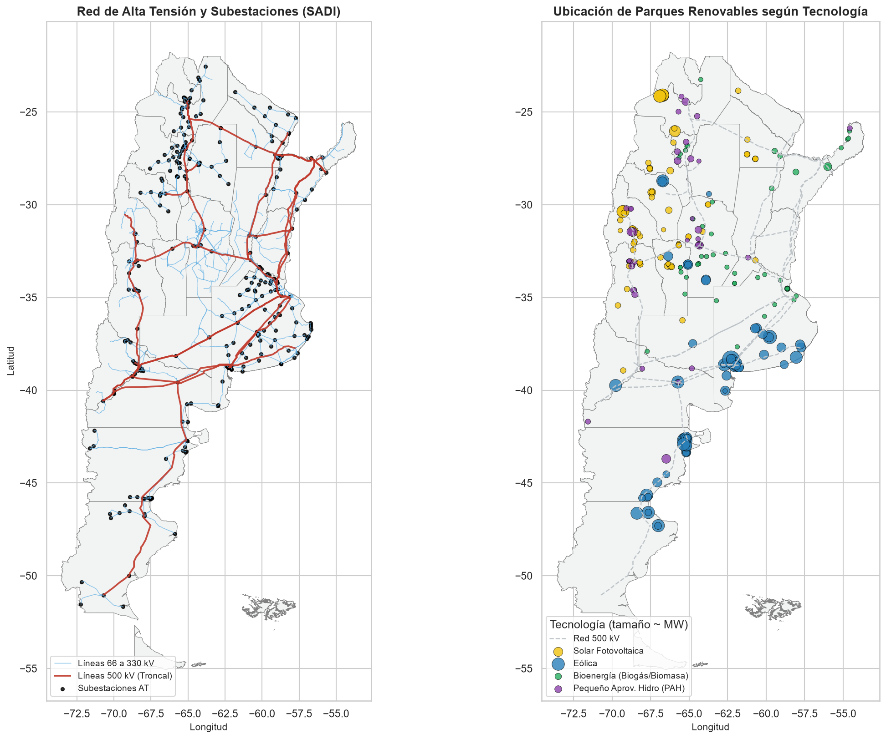
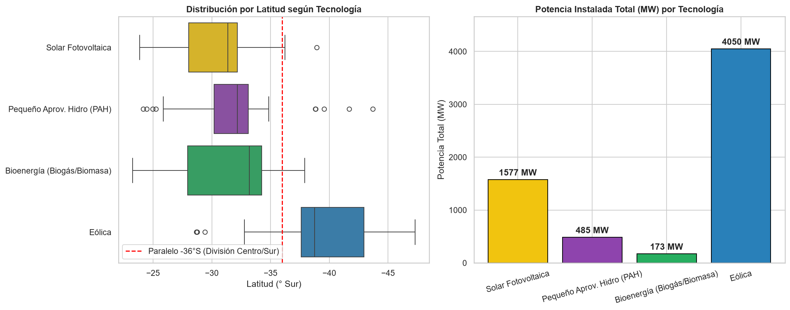
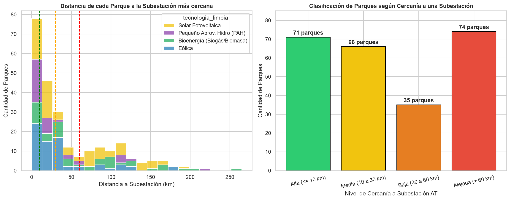
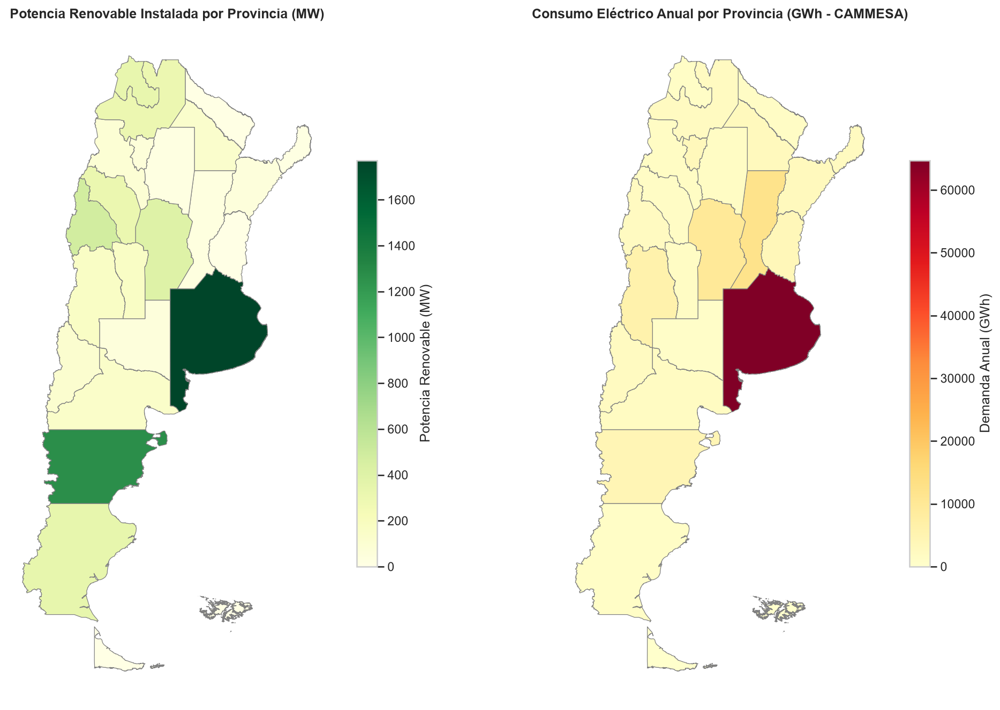
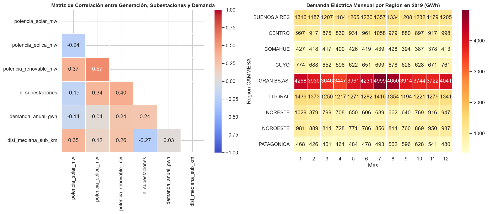

# Análisis Geoespacial de Energías Renovables, Red de Alta Tensión (SADI) y Demanda Eléctrica en Argentina

Proyecto desarrollado en el marco del **Módulo 4 (Visualización de Datos)** de la **Diplomatura en Ciencia de Datos y Análisis Avanzado (UTN.BA)**.

**Integrantes del Grupo:**
* **Nouvard, Ezequiel**
* **Ojeda, Wanda**
* **Passero, Genaro Agustín**
* **Urbina Salazar, Laida**

---

## Descripción del Proyecto

En Argentina, el potencial de generación de energías limpias presenta una marcada especialización geográfica:
* **Norte y Cuyo (NOA/Cuyo):** Concentración de **parques solares fotovoltaicos** debido a los altos niveles de radiación solar directa.
* **Sur (Patagonia y Sur de Buenos Aires):** Concentración de **parques eólicos** de alta potencia gracias a la constancia y velocidad de los vientos.

Sin embargo, más del **70% de la demanda eléctrica nacional** se concentra en la franja central del país (AMBA, Provincia de Buenos Aires, Santa Fe y Córdoba). Para transportar esta energía cientos de kilómetros minimizando las pérdidas técnicas por caída de tensión, los parques deben inyectar su energía en **Estaciones Transformadoras (Subestaciones)** que eleven la tensión a niveles de Alta y Extra Alta Tensión (**132 kV a 500 kV**).

### Objetivos del Análisis
1. Analizar y visualizar la distribución espacial y latitudinal de los parques renovables según su tecnología (**Norte Solar vs. Sur Eólico**).
2. Calcular mediante árboles de búsqueda espacial (`scipy.spatial.cKDTree`) y proyecciones métricas (`EPSG:32720` — UTM Zona 20S) la distancia en kilómetros desde cada parque renovable hasta su **Estación Transformadora de Alta Tensión** más cercana.
3. Cruzar espacialmente (`gpd.sjoin`) la oferta renovable y la red de subestaciones con los polígonos provinciales del **IGN** y los registros de demanda eléctrica mayorista de **CAMMESA**.

---

## Principales Visualizaciones

### 1. Red de Alta Tensión (SADI), Subestaciones y Parques Renovables

### 2. Distribución por Latitud ("Norte Solar vs. Sur Eólico") y Potencia Instalada

### 3. Análisis de Proximidad (`cKDTree`): Distancia a Estaciones Transformadoras

### 4. Comparación Provincial: Potencia Renovable Instalada vs. Consumo Eléctrico (CAMMESA)

### 5. Matrices de Calor (Heatmaps): Correlación y Estacionalidad Mensual por Región

---

## Stack Tecnológico y Herramientas

* **Lenguaje:** Python 3.12
* **Análisis Geoespacial:** `GeoPandas`, `Shapely`, `PyProj` (`EPSG:4326` y `EPSG:32720`), `SciPy` (`cKDTree`)
* **Procesamiento de Datos:** `Pandas`, `NumPy`
* **Visualización Estática e Interactiva:** `Matplotlib`, `Seaborn`, `Folium` (`Choropleth`, `GeoJsonTooltip`, `AntPath`)

---

## Estructura del Repositorio

* `TP_Visualizacion_Energias_Renovables.ipynb`: Cuaderno Jupyter completo con la exploración (EDA), limpieza, reproyección cartográfica, cruces espaciales, visualizaciones y conclusiones.
* `mapa_interactivo_energias_renovables.html`: Mapa coroplético interactivo en `Folium` con capas seleccionables y tooltips por provincia y parque renovable.
* `mapa_animado_flujo_energia.html`: Mapa interactivo con vectores de flujo animados (`AntPath`) entre los parques renovables, sus subestaciones más cercanas y la red troncal de 500 kV.
* `figuras/`: Gráficos y mapas estáticos exportados en alta resolución.
* `datos/`: Datasets oficiales descargados de **Datos Argentina (`datos.gob.ar`)**, **Secretaría de Energía**, **CAMMESA** e **Instituto Geográfico Nacional (IGN)**.
